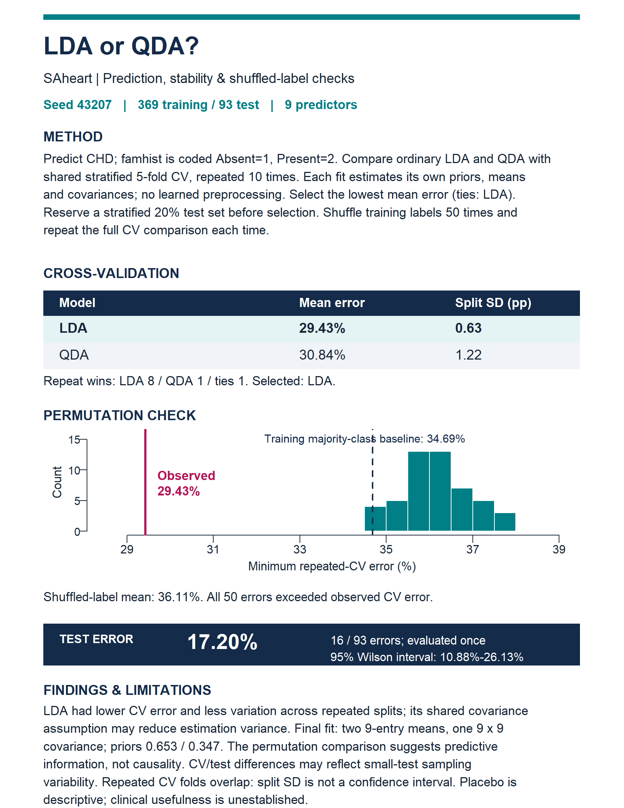

All analyses use R. Confusion matrices have observed classes in rows and predicted classes in columns.

## Question 1: LDA

### (a) Class priors, means, and pooled covariance

```{r q1a}
heart <- read.csv("data/saheart.csv")
heart$famhist <- factor(heart$famhist, levels = c("Absent", "Present"))
X <- data.matrix(heart[, names(heart) != "chd"])
y <- heart$chd

classes <- sort(unique(y))
n <- nrow(X)
p <- ncol(X)
K <- length(classes)

prior <- sapply(classes, function(k) mean(y == k))
names(prior) <- classes
mu <- t(sapply(classes, function(k) {
  colMeans(X[y == k, , drop = FALSE])
}))
rownames(mu) <- classes

Sigma <- matrix(0, p, p)
for (j in seq_along(classes)) {
  Z <- sweep(X[y == classes[j], , drop = FALSE], 2, mu[j, ], "-")
  Sigma <- Sigma + crossprod(Z)
}
Sigma <- Sigma / (n - K)
dimnames(Sigma) <- list(colnames(X), colnames(X))

prior
knitr::kable(mu, digits = 4, caption = "Class means")
knitr::kable(Sigma, digits = 4, caption = "Pooled within-class covariance")
```

We estimate the priors by $n_k/n$ and use each class's sample mean. The pooled covariance is

$$
\hat{\Sigma}=\frac{1}{n-K}\sum_k\sum_{i:y_i=k}
(x_i-\hat{\mu}_k)(x_i-\hat{\mu}_k)^{\mathsf T}.
$$

Here, $n=462$ and $K=2$, so the denominator is 460.

### (b) Manual LDA prediction

```{r q1b}
scores <- matrix(NA_real_, n, K)
for (j in seq_along(classes)) {
  w <- solve(Sigma, mu[j, ])
  scores[, j] <- as.vector(X %*% w) -
    0.5 * sum(mu[j, ] * w) + log(prior[j])
}
pred_manual <- classes[max.col(scores, ties.method = "first")]

data.frame(
  Object = c("X", "y", "mu", "Sigma", "scores"),
  Dimensions = c(paste(dim(X), collapse = " x "), length(y),
                 paste(dim(mu), collapse = " x "),
                 paste(dim(Sigma), collapse = " x "),
                 paste(dim(scores), collapse = " x "))
)
cm_manual <- table(
  Observed = factor(y, levels = classes),
  Predicted = factor(pred_manual, levels = classes)
)
cm_manual
mean(pred_manual != y)
```

Each observation is assigned to the class with the largest LDA score. The training error is **`r round(100 * mean(pred_manual != y), 2)`%**; this is an in-sample error.

### (c) Compare with MASS::lda

```{r q1c}
fit_lda <- MASS::lda(
  x = X,
  grouping = factor(y, levels = classes),
  prior = as.numeric(prior)
)
pred_lda <- predict(fit_lda, X)$class
cm_lda <- table(
  Observed = factor(y, levels = classes),
  Predicted = factor(pred_lda, levels = classes)
)
cm_lda
same_predictions <- all(as.character(pred_manual) == as.character(pred_lda))
same_predictions
```

The manual calculation and `MASS::lda` give identical predictions and confusion matrices.

```{r q1check, include=FALSE}
stopifnot(n == 462, p == 9, K == 2, length(y) == n,
          identical(dim(mu), c(2L, 9L)),
          identical(dim(Sigma), c(9L, 9L)),
          identical(dim(scores), c(462L, 2L)),
          same_predictions, sum(cm_manual) == n,
          all(cm_manual == cm_lda), all(is.finite(scores)))
```

## Question 2: QDA and marginal screening

```{r q2data}
zip_train <- read.csv(gzfile("data/zip-train.csv.gz"), header = FALSE)
zip_test <- read.csv(gzfile("data/zip-test.csv.gz"), header = FALSE)
ytr <- zip_train[[1]]
yte <- zip_test[[1]]
xtr <- as.matrix(zip_train[, -1])
xte <- as.matrix(zip_test[, -1])

pixel_order <- order(apply(xtr, 2, var), decreasing = TRUE)
digits <- 0:9
run_qda <- function(m) {
  chosen <- pixel_order[seq_len(m)]
  fit <- MASS::qda(
    x = xtr[, chosen, drop = FALSE],
    grouping = factor(ytr, levels = digits)
  )
  pred <- predict(fit, xte[, chosen, drop = FALSE])$class
  list(
    confusion = table(
      Observed = factor(yte, levels = digits),
      Predicted = factor(pred, levels = digits)
    ),
    error = mean(as.character(pred) != as.character(yte))
  )
}
```

Pixels are ranked using training-set marginal variances, without standardization. The same selected pixels are retained in the test set.

### (a) Forty predictors

```{r q2a}
result40 <- run_qda(40)
result40$confusion
result40$error
```

The test misclassification rate is **`r round(100 * result40$error, 2)`%**.

### (b) Interpretation

QDA fits successfully: all ten within-class covariance matrices have full rank with 40 selected predictors. Using fewer predictors resolves the singularity problem here and makes covariance estimation easier. High marginal variance does not necessarily mean a pixel is useful for classification.

### (c) Ten predictors

```{r q2c}
result10 <- run_qda(10)
result10$confusion
result10$error
```

The test error increases to **`r round(100 * result10$error, 2)`%** with 10 predictors, compared with **`r round(100 * result40$error, 2)`%** with 40. Using only 10 predictors loses useful information about digit shapes, outweighing the benefit of simpler covariance estimation.

```{r q2check, include=FALSE}
ranks40 <- sapply(digits, function(k) {
  qr(scale(xtr[ytr == k, pixel_order[1:40], drop = FALSE], scale = FALSE))$rank
})
stopifnot(ncol(xtr) == 256, ncol(xte) == 256,
          all(ranks40 == 40), sum(result40$confusion) == length(yte),
          sum(result10$confusion) == length(yte), result10$error > result40$error,
          all(is.finite(xtr)), all(is.finite(xte)))
```

## Question 3: Compare LDA and QDA

We use seed **43207**, with **100 training and 1,000 test observations per class**. Both methods use all ten variables and equal class priors. The first two variables have means $(-1,0)$ and $(1,0)$, unit variances, and correlations $\rho$ and $-\rho$. The remaining eight variables are independent standard normals.

```{r q3setup}
set.seed(43207)
rhos <- c(0, 0.2, 0.4, 0.6, 0.8, 0.9)

sample_data <- function(rho, n) {
  S <- diag(10)
  S[1, 2] <- S[2, 1] <- rho
  X1 <- MASS::mvrnorm(n, c(-1, rep(0, 9)), S)
  S[1, 2] <- S[2, 1] <- -rho
  X2 <- MASS::mvrnorm(n, c(1, rep(0, 9)), S)
  list(x = rbind(X1, X2), y = factor(rep(1:2, each = n)))
}

simulate <- function(rho) {
  train <- sample_data(rho, 100)
  test <- sample_data(rho, 1000)
  lda <- MASS::lda(train$x, train$y, prior = c(0.5, 0.5))
  qda <- MASS::qda(train$x, train$y, prior = c(0.5, 0.5))
  c(LDA = mean(predict(lda, test$x)$class != test$y),
    QDA = mean(predict(qda, test$x)$class != test$y))
}
```

### (a) One dataset per rho

```{r q3a}
single <- t(sapply(rhos, simulate))
knitr::kable(data.frame(rho = rhos, single), digits = 4,
             caption = "Single-run test misclassification rates")
```

Within each setting, the two classifiers use the same training and test observations.

### (b) Fifty repetitions per rho

```{r q3b, fig.width=7, fig.height=4}
averages <- t(sapply(rhos, function(rho) {
  rowMeans(replicate(50, simulate(rho)))
}))
knitr::kable(data.frame(rho = rhos, averages), digits = 4,
             caption = "Mean test misclassification rates over 50 repetitions")

matplot(rhos, averages, type = "b", lwd = 2,
        pch = c(16, 17), lty = c(1, 2), col = c("#142B49", "#B31557"),
        xlab = expression(rho), ylab = "Mean test error")
legend("topright", c("LDA", "QDA"), lwd = 2,
       pch = c(16, 17), lty = c(1, 2),
       col = c("#142B49", "#B31557"), bty = "n")
```

### (c) Explanation

LDA has lower average error at small $\rho$: the class covariances are similar, and pooling reduces estimation variance. At large $\rho$, QDA performs better by allowing different class covariances, reducing bias. This is the bias-variance trade-off. The eight noise variables add no class information but introduce estimation noise, especially for QDA's separate covariance matrices.

```{r q3check, include=FALSE}
stopifnot(identical(dim(single), c(6L, 2L)),
          identical(dim(averages), c(6L, 2L)),
          all(is.finite(averages)), all(averages >= 0 & averages <= 1))
```

## Question 4: Create and use an LDA/QDA analysis skill

### (a) Define the skill

I created `lda-qda-stability/SKILL.md` to compare ordinary LDA and QDA using repeated cross-validation and a shuffled-label diagnostic. It is dataset-independent and requires a report of at most one printed page with a figure, table, and numerical results.

The skill is stored in this homework directory, outside automatically loaded skill folders. I supplied its path in an explicit request; it is not installed for automatic discovery.

```{r, echo=FALSE}
skill_path <- "lda-qda-stability/SKILL.md"
skill_bytes <- file.info(skill_path)$size
stopifnot(skill_bytes <= 5000)
```

The final skill file is **`r skill_bytes` bytes**, below the 5,000-byte limit.

### (b) Apply the skill

I explicitly invoked the skill using the following prompt:

```{r, results='asis', echo=FALSE}
cat("> ", readLines("q4-invocation.txt"), "\n", sep = "")
```

The seed was **43207**. Both candidates used all nine predictors with the Question 1 coding. The fixed stratified split reserved 93 observations for testing and left 369 for training. I compared the candidates using the same stratified five-fold partitions, repeated ten times. All means, covariances, and empirical priors were estimated within each fold's training portion. No scaling, imputation, or embedding was needed.

For the placebo diagnostic, I shuffled only the training labels 50 times. Each shuffle repeated the same model-selection procedure, generating shared stratified folds for LDA and QDA and recording the lower mean CV error. This diagnostic was not used to tune the models.

### (c) Review and submit

Before evaluating the test set, the agent checked the coding, shared folds, fitting-sample priors, and training-only placebo procedure. All model fits completed without rank failures. LDA had the lower mean CV error, so that selection was frozen. No skill revisions were needed. The training-only review is saved in `q4-output/training-review.txt`.

The agent then refitted LDA on all training observations and evaluated it once on the reserved test set. Subsequent report rendering reads saved results and does not refit or reevaluate the test set. The code blocks below are displayed for reproducibility rather than executed when this document renders.

#### Final one-page analysis report

The following report is also provided as the one-page PDF `q4-output/q4-report.pdf`.

{width=850px}

#### Complete skill

```{r, results='asis', echo=FALSE}
cat("```markdown\n", paste(readLines(skill_path), collapse = "\n"), "\n```\n", sep = "")
```

#### Reproducible R analysis

From the `homework/week-07` directory, run `Rscript q4-analysis.R train`, review the training results and save the review, then run `Rscript q4-analysis.R test`. Run `Rscript q4-report.R` to export the report from saved final results. The analysis script stops if final results already exist, preventing accidental test reevaluation.

```{r, results='asis', echo=FALSE}
cat("```r\n", paste(readLines("q4-analysis.R"), collapse = "\n"), "\n```\n", sep = "")
```
